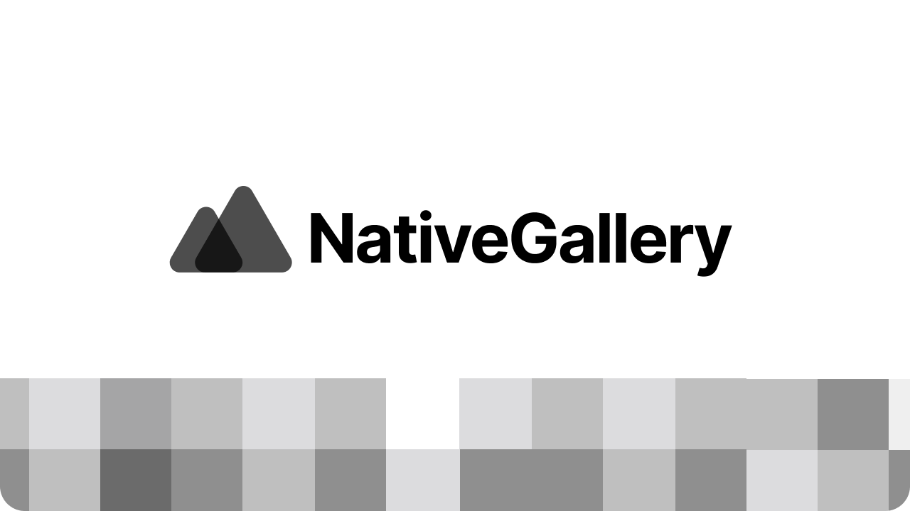

# NativeGallery

NativeGallery - это реверсивный open-source движок популярного сайта transphoto.org (СТТС), RailGallery, Fotobus и ему подобных.

# Почему я должен использовать ваш движок?
* **Свобода**: СТТС не предоставляет всем свой исходный код для создания отдельных подобных ему сайтов. С NativeGallery вы сможете обойти это предпятствие!
* **Гибкость**: Настраивайте сайт по вашим предпочтениям: управляйте приватностью разделов, настраивайте дизайн сайта, назначайте администраторов, фотомодераторов и многое другое!
* **Скорость**: Next.js, NestJS и Prisma поверх MySQL/MariaDB!

# Системные требования
Мы настоятельно рекомендуем устанавливать движок на VPS/VDS/выделенный сервер. Поддержка на Shared-хостингах не осуществляется!

**Операционная система**: Ubuntu 20.04 и выше\
**Node.js:** 22 и выше\
**База данных**: MySQL 8.0 и выше\
**ffmpeg**: для обработки видео

# Структура
* `apps/frontend` — сайт на Next.js. Все данные получает из API; запросы `/api/*` и медиафайлы проксируются в API (`src/proxy.ts`).
* `apps/api` — REST API на NestJS.
* `apps/crons`, `apps/media-worker` — фоновые задачи и обработка медиа.
* `packages/database` — схема и миграции Prisma, `packages/contracts` — общие типы.

# Статус функционала
### Обязательные к выполнению функции
- [x] Авторизация, Регистрация
- [x] Просмотр профилей
- [ ] Публикация фото:
  - [x] Привязка сущности (Транспортное Средство, Поезд, Самокат, Камень и прочее)
  - [x] Загрузка фото
  - [x] GeoDB
  - [x] Геометка
  - [ ] Направление съёмки
  - [ ] Состояние фотографии
    - [x] Временная публикация
    - [x] Условная публикация
    - [x] Техническая публикация
    - [ ] Требует исправления
    - [ ] Возможность создания своих статусов
  - [x] Галереи
  - [x] Вид сущности (Трамвай, Метрополитен, Троллейбус и т.д)
- [x] GeoDB
- [ ] Фотоконкурс
- [ ] Поиск
  - [ ] Поиск по критериям
    - [ ] Дата публикации
    - [ ] Дата съёмки
    - [x] Поиск фотографий пользователя
- [ ] Сущности
  - [x] Страница сущности
  - [x] Статус (Эксплуатируется, списан и прочее)
  - [ ] Привязка к номеру
  - [x] Редактирование базы данных
- [ ] Фотографии:
  - [x] Просмотр
  - [x] Рейтинг
  - [x] Комментирование
  - [x] Рейтинг комментариев
  - [x] Избранные фотографии
  - [x] Полноценный EXIF
  - [x] Модерация
  - [ ] Редактирование
- [ ] Обновления:
  - [x] Новые фотографии
  - [x] Новые фотографии из подписок
  - [ ] Новые фотографии по городам (требуется GeoDB)
- [ ] Комментарии:
  - [x] Публикация
  - [ ] Модерация
  - [x] Рейтинг
  - [ ] BB-коды
  - [ ] Форматирование
  - [x] Удаление
  - [x] Редактирование
### Необязательные, но будет неплохо их сделать тоже
  - [ ] Авторизация
    - [ ] Через Telegram
    - [ ] Через ВКонтакте
    - [ ] Через Google
    - [ ] Через Яндекс
    - [ ] Через Twitter
    - [ ] Через Facebook
    - [ ] Через Discord
    - [ ] Через Steam (?!)
    - [ ] Сторонняя авторизация через API
  - [ ] Автоматическое обновление движка через Админ-панель
  - [ ] СТТС.Клуб (Native Clubs)
    - [ ] Отметки людей на фотографиях
    - [ ] Прямой эфир (https://sttsclub.ru/live/)
  - [ ] СТТС.Форум (NativeGallery Forum)
  - [ ] Экспорт всех фотографий и данных с аккаунта

# Установка
* Убедитесь, что вы предварительно установили на своём сервере Node.js 22, MySQL версии 8.0 и выше и ffmpeg.
* Скачайте или склонируйте репозиторий.
* Скопируйте `.env.example` в `.env` и сконфигурируйте ваш сервер NativeGallery (`DATABASE_URL`, `SITE_TITLE`, `MEDIA_ROOT` и т.д.).
* Установите зависимости и соберите проект: `npm ci && npm run build`
* Примените миграции базы данных: `npm run db:deploy`. Если база уже создана PHP-версией движка, сначала отметьте базовую миграцию как применённую: `npx prisma migrate resolve --applied 0_legacy --schema packages/database/prisma/schema.prisma`
* Запустите API, фоновые задачи и сайт:
  * `npm start -w @nativegallery/api`
  * `npm start -w @nativegallery/crons`
  * `npm start -w @nativegallery/media-worker`
  * `npm start -w @nativegallery/frontend` (адрес API задаётся переменной `API_ORIGIN`, по умолчанию `http://127.0.0.1:3001`)
* Для режима технических работ задайте `MAINTENANCE=true` перед запуском сайта.
* Если вы всё сделали правильно, то вы увидите пустую главную страницу вашей галереи.
* Готово! Ваш сервер NativeGallery (aka СТТС) готов к работе.
